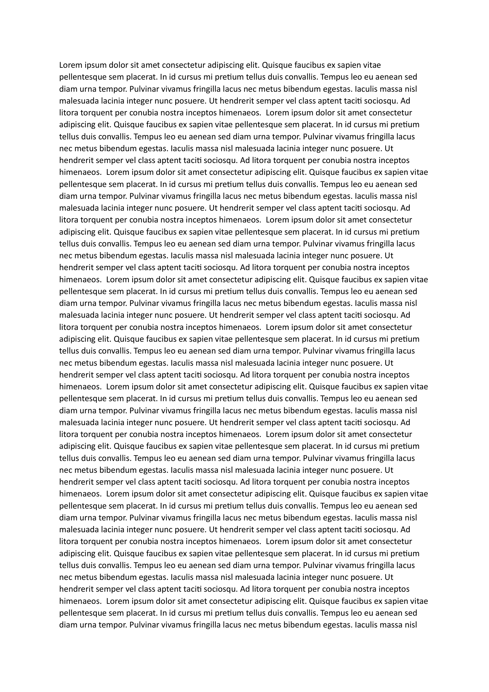
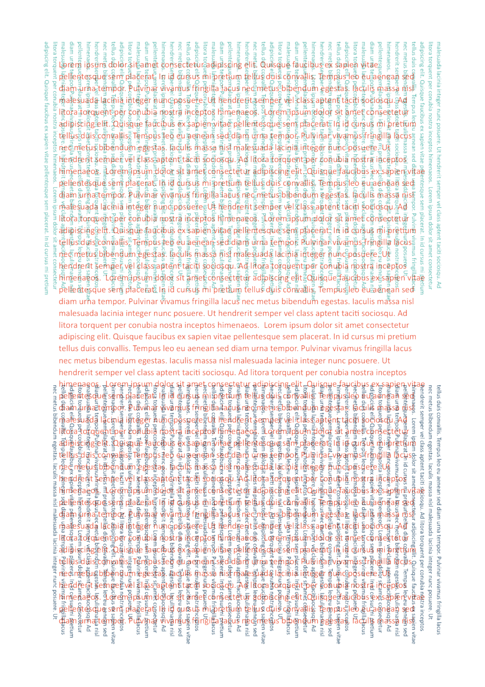

# Cheat Sheet Compressor

A client-side web app that overlays multiple PDF pages into a single composite image using colour tinting and multiply blending — perfect for creating ultra-dense cheat sheets for exams.

**[Live demo → ttithipan.github.io/cheat-sheet-stacker](https://ttithipan.github.io/cheat-sheet-stacker/)**

## Example

Input → Output: a 3-page PDF becomes a single tri-colour composite page.

| Raw (3 pages) | Processed (1 page) |
|---|---|
|  |  |

## How It Works

1. Select a multi-page PDF (lecture notes, study guides, etc.)
2. Pages are grouped into triplets
3. Each triplet is composited into one image:
   - **Page 1** — normal orientation, tinted with the primary colour
   - **Page 2** — rotated 90° clockwise, tinted with the secondary colour
   - **Page 3** — rotated 90° clockwise, tinted with the tertiary colour
4. All layers are **multiply-blended** — dark pixels (text) show through in their tinted colour, light pixels (background) become transparent white
5. Download the result as a PDF

Because different colours are used for each page, you can visually separate which text came from which page — all on a single sheet.

## Tech Stack

- **React 19** + **Vite** — UI framework & build tool
- **Tailwind CSS 4** + **MUI** — styling & components
- **pdfjs-dist** — PDF rendering in the browser
- **Canvas API** — image processing (tint, rotate, multiply blend)
- **jsPDF** — client-side PDF generation for download

Everything runs **100% client-side**. No files are uploaded to any server.

## Getting Started

```bash
# Install dependencies
npm install

# Start dev server
npm run dev

# Build for production (outputs to dist/)
npm run build
```

### Deploying to GitHub Pages

The `vite.config.js` automatically sets the base path to `/cheat-sheet-stacker/` during production builds.

```bash
npm run build
# Deploy the dist/ folder to your gh-pages branch
```

## Project Structure

```
├── public/                Static assets (favicon, icons)
├── sample/                Sample input & output PDFs
│   ├── raw.pdf            3-page input
│   └── processed.pdf      1-page composite output
├── src/
│   ├── App.jsx            Main app layout & state
│   ├── main.jsx           React entry point
│   ├── processor.js       PDF rendering & compositing logic
│   ├── index.css          Global styles & Tailwind
│   └── components/
│       ├── PreviewCanvas.jsx   Canvas display & empty state
│       ├── Sidebar.jsx         Settings, nav, privacy
│       └── TopRibbon.jsx       Burger menu & title bar
├── index.html             HTML entry point
├── vite.config.js         Vite build configuration
├── package.json           Dependencies & scripts
└── README.md
```

## License

GNU GPLv3 © 2026
